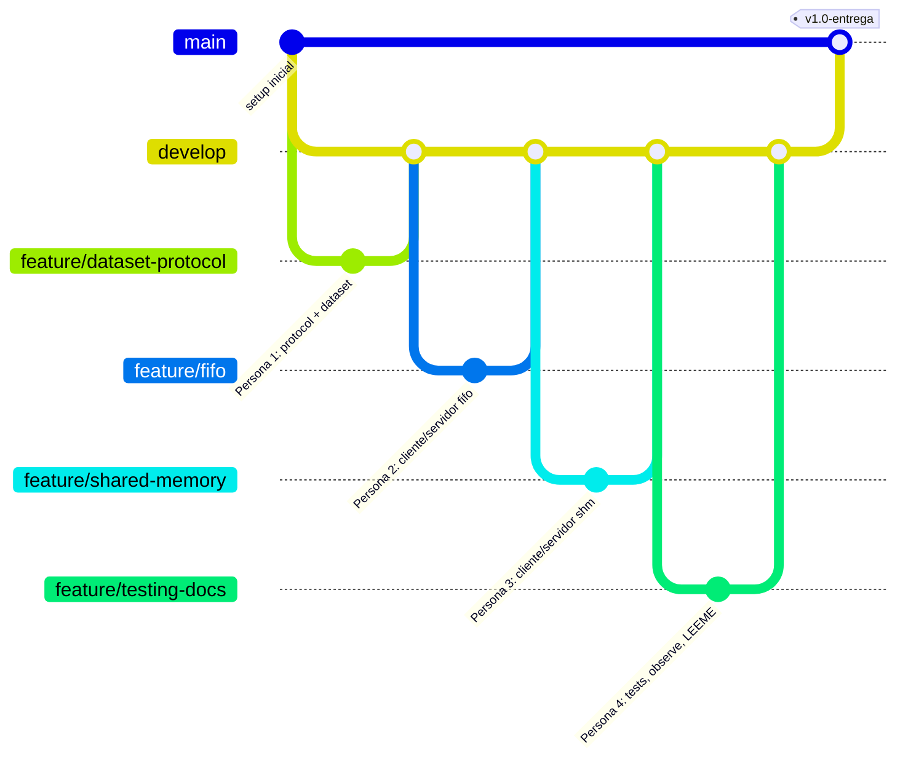

# Guía de Trabajo para el Equipo: 4 Integrantes y 4 Ramas
**Práctica 1 de Sistemas Operativos — Universidad Nacional de Colombia**

Esta guía es un manual práctico dirigido a los **4 integrantes del grupo**. Explica paso a paso qué debe hacer cada persona, en qué rama debe trabajar, qué archivos le corresponden, cómo probar su componente y cómo integrarlo con el resto del proyecto.

---

## 1. Visión General del Proyecto

- **Objetivo:** Sistema cliente-servidor en lenguaje C sobre Linux (WSL2 Ubuntu 24.04) que busca ciudades en el archivo `data/worldcities.csv` (44.692 líneas) sin cargarlo completo en memoria RAM ($O(1)$ RAM).
- **Dos arquitecturas idénticas en funcionalidad:**
  1. **Versión A (FIFO):** 2 tuberías nombradas (`/tmp/so_p1_req.fifo` y `/tmp/so_p1_resp.fifo`).
  2. **Versión B (SHM):** Memoria compartida System V (`shmget`, `shmat`, `shmdt`, `shmctl`) con 3 semáforos POSIX process-shared (`req_ready`, `resp_ready`, `resp_consumed`).
- **Criterios de búsqueda acordados:**
  1. Ciudad ASCII (`city_ascii`, ej. `Bogota`, `Tokyo`)
  2. País (`country`, ej. `Colombia` -> devuelve múltiples resultados en streaming)
  3. Código ISO2 (`iso2`, ej. `CO`, `JP`)
  4. Salir (`OP_EXIT`)
  *(Insensible a mayúsculas/minúsculas usando `strcasecmp`).*

---

## 2. Estructura de Carpetas del Proyecto

```text
practica1_so/
├── data/
│   └── worldcities.csv        # Dataset con 44.692 registros (en disco, streaming con getline)
├── include/
│   ├── protocol.h             # Definición de Request, Response, SharedBlock, constantes y enums
│   ├── dataset.h              # Prototipos del parser y search_dataset()
│   └── ipc_utils.h            # Prototipos de read_full(), write_full() y manejo de señales
├── src/
│   ├── dataset.c              # Parser de comillas CSV y búsqueda secuencial línea a línea
│   ├── ipc_utils.c            # Implementación robusta de read_full, write_full y sigaction
│   ├── cliente_fifo.c         # Cliente interactivo y CLI para versión FIFO
│   ├── servidor_fifo.c        # Servidor de búsqueda para versión FIFO
│   ├── cliente_shm.c          # Cliente interactivo y CLI para versión Memoria Compartida
│   └── servidor_shm.c         # Servidor de búsqueda para versión Memoria Compartida
├── scripts/
│   ├── test_matrix.sh         # Suite automatizada de pruebas (F1-F6 y E1-E6)
│   ├── observe.sh             # Script con comandos de observabilidad (ps, /proc, lsof, strace, ipcs)
│   └── cleanup_ipc.sh         # Script de emergencia para limpiar FIFOs y SHM residuales
├── tests/
│   └── test_parser.c          # Harness de prueba para validar el parser y dataset sin IPC
├── Makefile                   # Reglas de compilación estricta (-Wall -Wextra -Wpedantic -pthread)
├── GUIA_ORGANIZACION.md       # Documento maestro con las 10 fases, preguntas de sustentación y rúbrica
├── GUIA_EQUIPO.md             # Esta guía rápida por integrante y rama
├── LEEME.md                   # Documentación técnica final de entrega para el profesor
├── README.md                  # Presentación general del repositorio
└── .gitignore                 # Filtro de binarios compilados y temporales
```

---

## 3. Modelo de Trabajo en Git



### Reglas básicas de Git:
1. **NUNCA hacer commit directo a `main`.**
2. Cada integrante trabaja **exclusivamente en su rama de características**.
3. Al terminar su trabajo, sincroniza y solicita revisión a su compañero asignado (Revisión Cruzada).
4. El revisor aprueba y se integra la rama en `develop`.

---

## 4. Manual Detallado por Integrante

---

### 👤 Persona 1: Dataset y Protocolo Común
- **Rama asignada:** `feature/dataset-protocol`
- **Revisor asignado:** Persona 3
- **Comandos para empezar:**
  ```bash
  git checkout feature/dataset-protocol
  git pull origin feature/dataset-protocol   # (si hay cambios remotos)
  ```
- **Archivos a su cargo:**
  1. `include/protocol.h`:
     - Definir enums `Operation` (`OP_CITY`, `OP_COUNTRY`, `OP_ISO2`, `OP_EXIT`) y `ResponseType` (`RESP_ROW`, `RESP_END`, `RESP_NOT_FOUND`, `RESP_ERROR`, `RESP_BYE`).
     - Definir estructuras `Request` (campo `value[128]`), `Response` (campo `text[512]`) y `SharedBlock`.
     - Definir constantes `#define FIFO_REQ "/tmp/so_p1_req.fifo"`, `#define FIFO_RESP "/tmp/so_p1_resp.fifo"`, `#define SHM_KEY 0x503141`.
  2. `include/dataset.h` y `src/dataset.c`:
     - Parser CSV carácter a carácter que maneje comillas dobles, comas internas (ej. `"Washington, D.C."`) y retornos `\r\n`.
     - Función `search_dataset(path, req, emit_fn, ctx)` que lea secuencialmente con `getline()`.
     - Comparaciones insensibles a mayúsculas con `strcasecmp()`.
  3. `tests/test_parser.c`:
     - Programa de prueba aislado para buscar "Tokyo", "Colombia", "CO" y "CiudadInexistente" sin usar todavía FIFOs ni SHM.
- **Cómo validar tu trabajo:**
  ```bash
  gcc -Wall -Wextra -Iinclude src/dataset.c tests/test_parser.c -o test_parser
  ./test_parser
  ```
- **Cómo entregar tu rama:**
  ```bash
  git add include/protocol.h include/dataset.h src/dataset.c tests/test_parser.c
  git commit -m "feat: implement protocol structures and CSV sequential parser"
  git push origin feature/dataset-protocol
  ```

---

### 👤 Persona 2: Versión A (Tuberías Nombradas / FIFOs)
- **Rama asignada:** `feature/fifo`
- **Revisor asignado:** Persona 4
- **Comandos para empezar:**
  ```bash
  git checkout feature/fifo
  ```
- **Archivos a su cargo:**
  1. `src/servidor_fifo.c`:
     - Crear FIFOs de forma idempotente con `mkfifo("/tmp/so_p1_req.fifo", 0660)` y `mkfifo("/tmp/so_p1_resp.fifo", 0660)`.
     - Orden de apertura bloqueante: abrir `FIFO_REQ` en `O_RDONLY` y luego `FIFO_RESP` en `O_WRONLY`.
     - Proteger contra caída por desconexión del cliente ignorando `SIGPIPE`: `signal(SIGPIPE, SIG_IGN)` y chequear `errno == EPIPE`.
     - Bucle de servicio: recibir `Request` con `read_full()`. Si es búsqueda, invocar `search_dataset()`; si es `OP_EXIT`, enviar `RESP_BYE`, cerrar descriptores y hacer `unlink()` de las dos FIFOs.
  2. `src/cliente_fifo.c`:
     - Abrir `FIFO_REQ` en `O_WRONLY` y luego `FIFO_RESP` en `O_RDONLY`.
     - Presentar menú por consola con opciones 1 a 4.
     - Enviar `Request` con `write_full()`.
     - Bucle de lectura con `read_full()` imprimiendo respuestas hasta recibir `RESP_END`, `RESP_NOT_FOUND` o `RESP_BYE`.
- **Cómo validar tu trabajo:**
  - Abrir dos terminales:
    - Terminal 1: `./servidor_fifo`
    - Terminal 2: `./cliente_fifo`
  - Realizar búsquedas de "Tokyo", "Colombia" (múltiples filas) y seleccionar opción 4 (Salir). Verificar que `/tmp/so_p1_*.fifo` se eliminen automáticamente.
- **Cómo entregar tu rama:**
  ```bash
  git add src/servidor_fifo.c src/cliente_fifo.c
  git commit -m "feat: implement complete FIFO client and server with SIGPIPE handling"
  git push origin feature/fifo
  ```

---

### 👤 Persona 3: Versión B (Memoria Compartida System V + Semáforos)
- **Rama asignada:** `feature/shared-memory`
- **Revisor asignado:** Persona 1
- **Comandos para empezar:**
  ```bash
  git checkout feature/shared-memory
  ```
- **Archivos a su cargo:**
  1. `src/servidor_shm.c`:
     - Crear bloque de memoria System V con `shmget(SHM_KEY, sizeof(SharedBlock), IPC_CREAT | 0660)` y enlazar con `shmat()`.
     - Inicializar los 3 semáforos POSIX en memoria compartida:
       - `sem_init(&shm->req_ready, 1, 0)` (`pshared=1`)
       - `sem_init(&shm->resp_ready, 1, 0)`
       - `sem_init(&shm->resp_consumed, 1, 0)`
     - Bucle: esperar solicitud con `sem_wait(&shm->req_ready)`.
     - Por cada fila encontrada:
       1. Copiar fila a `shm->response`.
       2. Señalizar disponibilidad: `sem_post(&shm->resp_ready)`.
       3. Esperar confirmación de lectura del cliente: `sem_wait(&shm->resp_consumed)` (**evita que se sobrescriba el buffer antes de que el cliente lo lea**).
     - Al salir: destruir semáforos con `sem_destroy()`, desenlazar con `shmdt()` y destruir segmento en el kernel con `shmctl(shmid, IPC_RMID, NULL)`.
  2. `src/cliente_shm.c`:
     - Enlazarse al bloque existente con `shmget(SHM_KEY, sizeof(SharedBlock), 0660)` y `shmat()`.
     - Menú interactivo: copiar solicitud a `shm->request` y notificar con `sem_post(&shm->req_ready)`.
     - Bucle de lectura: `sem_wait(&shm->resp_ready)`, imprimir fila, y confirmar con `sem_post(&shm->resp_consumed)`.
- **Cómo validar tu trabajo:**
  - Ejecutar servidor y cliente en terminales separadas.
  - Comprobar con `ipcs -m` que el bloque de memoria existe con permisos 660.
  - Al salir normalmente, comprobar con `ipcs -m` que el bloque se eliminó del sistema.
- **Cómo entregar tu rama:**
  ```bash
  git add src/servidor_shm.c src/cliente_shm.c
  git commit -m "feat: implement shared memory and 3-semaphore synchronization"
  git push origin feature/shared-memory
  ```

---

### 👤 Persona 4: Integración, Herramientas del SO, Pruebas y Documentación
- **Rama asignada:** `feature/testing-docs`
- **Revisor asignado:** Persona 2
- **Comandos para empezar:**
  ```bash
  git checkout feature/testing-docs
  ```
- **Archivos a su cargo:**
  1. `Makefile`:
     - Compilación estricta con flags: `CFLAGS = -Wall -Wextra -Wpedantic -std=c11 -D_GNU_SOURCE -Iinclude`, `LDFLAGS = -pthread`.
     - Targets: `all`, `cliente_fifo`, `servidor_fifo`, `cliente_shm`, `servidor_shm`, `clean`, `clean-ipc`, `test`.
  2. `include/ipc_utils.h` y `src/ipc_utils.c`:
     - Implementar `read_full()` y `write_full()` que manejen fragmentación de bytes, `EINTR` y `EPIPE`.
     - Implementar registro de manejadores `sigaction()` para captura limpia de `SIGINT` y `SIGTERM`.
  3. `scripts/test_matrix.sh`:
     - Script ejecutable que automatice las pruebas F1-F6 y E1-E6.
  4. `scripts/observe.sh`:
     - Script interactivo con menú para inspeccionar en vivo con `ps`, `pstree`, `/proc/<pid>/fd`, `/proc/<pid>/wchan`, `lsof`, `strace` e `ipcs`.
  5. `scripts/cleanup_ipc.sh`:
     - Script de limpieza de emergencia (`rm -f /tmp/so_p1_*.fifo` e `ipcrm -m <shmid>`).
  6. `LEEME.md`:
     - Documentar la entrega completa según la rúbrica oficial, incluyendo **las dos observaciones concretas de Linux obtenidas con `strace` y `/proc`**.
- **Cómo validar tu trabajo:**
  ```bash
  make clean && make
  bash scripts/test_matrix.sh
  ```
- **Cómo entregar tu rama:**
  ```bash
  git add Makefile include/ipc_utils.h src/ipc_utils.c scripts/* LEEME.md
  git commit -m "feat: add build system, ipc utilities, test matrix and LEEME documentation"
  git push origin feature/testing-docs
  ```

---

## 5. Tabla de Herramientas del Sistema Operativo Obligatorias

El enunciado exige que el grupo observe el comportamiento del programa desde Linux y documente al menos **dos observaciones concretas** en `LEEME.md`. Durante la sustentación (40%), el profesor pedirá usar estas herramientas:

| Herramienta | Uso Esperado en la Práctica | Comando Ejemplo para Probar |
| :--- | :--- | :--- |
| **`ps` / `pstree`** | Identificar PID, PPID, estado y verificar que cliente y servidor **no son procesos emparentados** (no creados con `fork()`). | `ps -o pid,ppid,stat,wchan,cmd -C servidor_fifo`<br>`pstree -p` |
| **`/proc/<pid>/`** | Examinar información que el kernel expone sobre el proceso (`status`, descriptores y función de espera). | `cat /proc/$PID/status`<br>`ls -l /proc/$PID/fd`<br>`cat /proc/$PID/wchan` |
| **`lsof`** | Identificar archivos y descriptores abiertos: ver los dos extremos de las FIFOs en `/tmp` y el archivo `worldcities.csv` abierto por el servidor. | `lsof -p $PID_SERVIDOR`<br>`lsof /tmp/so_p1_req.fifo` |
| **`strace`** | Observar llamadas al sistema en tiempo real y evidenciar cuándo y dónde se bloquea un proceso. | `strace -f -e trace=openat,read,write,close ./servidor_fifo`<br>`strace -f -e trace=shmget,shmat,futex ./servidor_shm` |
| **`ipcs` / `ipcrm`** | Inspeccionar recursos IPC creados en el kernel (segmentos de memoria compartida) y eliminarlos si quedan huérfanos. | `ipcs -m`<br>`ipcrm -m <SHMID>` |
| **`top` / `htop`** | Observar estado y consumo de recursos durante la búsqueda, constatando que la memoria RAM se mantiene fija y baja ($O(1)$) porque el archivo se lee secuencialmente desde disco. | `top -p $PID_SERVIDOR` |

### Las Dos Observaciones Obligatorias para `LEEME.md`:
1. **Observación 1 (Bloqueo en FIFO con `strace` y `wchan`):**
   - Ejecutar el servidor FIFO solo.
   - Mostrar que `strace` se detiene en `read(...)` esperando datos en el descriptor de la FIFO.
   - Mostrar que `/proc/<PID>/wchan` contiene `pipe_read` y el estado en `/proc/<PID>/status` es `S (sleeping)`.
   - Mostrar cómo, al iniciar el cliente y enviar una consulta, `read()` retorna inmediatamente con los bytes recibidos.
2. **Observación 2 (Inspección y Limpieza de Memoria Compartida con `ipcs` e `ipcrm`):**
   - Iniciar `servidor_shm`, listar con `ipcs -m` mostrando `shmid`, `nattch = 1` y clave `0x00503141`.
   - Provocar una terminación abrupta con `kill -9 $PID_SERVIDOR` (simulando un fallo sin cleanup).
   - Mostrar que el segmento permanece huérfano en el kernel con `nattch = 0`.
   - Documentar la eliminación manual con `ipcrm -m <shmid>`.

---

## 6. Restricciones Técnicas Críticas (No olvidar)

- **Lenguaje:** C estándar sobre Linux.
- **Compilador:** `gcc` con `Makefile`.
- **Ejecutables separados:** Cliente y servidor son programas independientes (no usan `fork()` ni tuberías anónimas heredadas).
- **Verificación rigurosa de retornos:** En **todas** las llamadas al sistema (`fopen`, `getline`, `mkfifo`, `open`, `read`, `write`, `close`, `unlink`, `shmget`, `shmat`, `shmdt`, `shmctl`, `sem_init`, `sem_wait`, `sem_post`, `sem_destroy`), comprobar siempre si devuelven `-1` o `NULL` e informar el error con `perror()` o `fprintf(stderr, ...)`.
