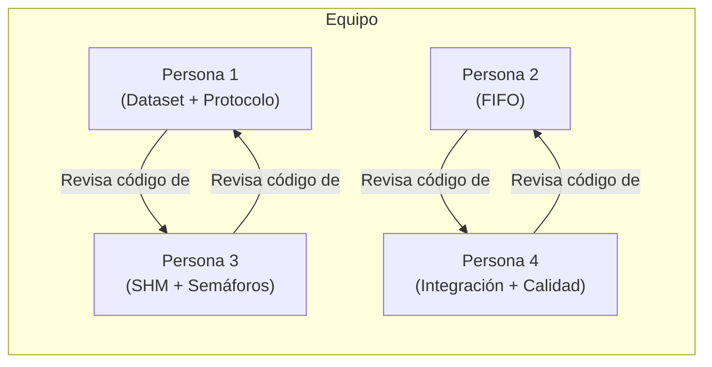
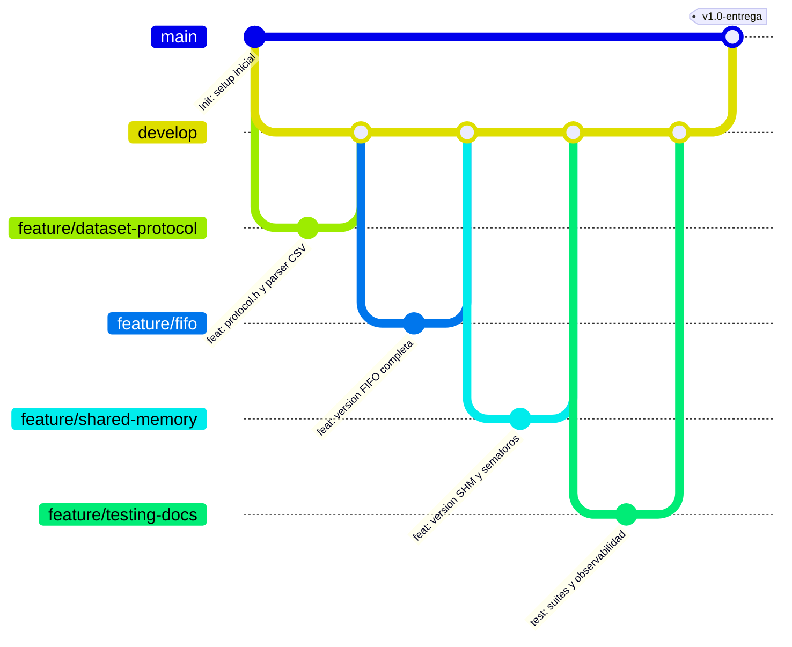
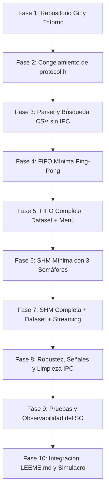

# Guía Completa de Organización y Desarrollo: Práctica 1 de Sistemas Operativos
**Procesos, Llamadas al Sistema e IPC en Linux (World Cities)**

---

## 1. Resumen Ejecutivo del Proyecto

- **Objetivo:** Construir una solución cliente-servidor en lenguaje C sobre Linux (bajo WSL2 Ubuntu 24.04 en Windows) para realizar búsquedas secuenciales sobre `data/worldcities.csv` (44.692 registros).
- **Dos arquitecturas obligatorias:**
  1. **Versión A (FIFO):** Tuberías nombradas bidireccionales (`/tmp/so_p1_req.fifo` y `/tmp/so_p1_resp.fifo`).
  2. **Versión B (SHM + Semáforos):** Segmento de memoria System V (`shmget`, `shmat`, `shmdt`, `shmctl`) con 3 semáforos POSIX process-shared (`sem_init` con `pshared=1`).
- **Restricción central:** El dataset permanece en disco ($O(1)$ RAM, procesado línea a línea con `getline()`).
- **Criterios de búsqueda confirmados:**
  1. Ciudad ASCII (`city_ascii`, ej. `Bogota`, `Tokyo`, `Sao Paulo`).
  2. País (`country`, ej. `Colombia`, devolviendo múltiples filas en streaming).
  3. Código ISO2 (`iso2`, ej. `CO`, `JP`, `US`).
  4. Salir (`OP_EXIT`).
  *(Comparaciones insensibles a mayúsculas/minúsculas con `strcasecmp`).*
- **Evaluación crítica:** La **sustentación individual pesa 40%**. Cualquier integrante puede ser interrogado sobre cualquier parte del sistema y herramientas de inspección del kernel (`strace`, `lsof`, `/proc`, `ps`, `ipcs/ipcrm`).

---

## 2. Repartición de Roles y Esquema de Revisión Cruzada (4 Personas)



| Integrante | Rol / Responsabilidad Principal | Entregables Concretos | Revisor Asignado |
| :--- | :--- | :--- | :--- |
| **Persona 1** | **Dataset + Protocolo Común** | • `include/protocol.h`<br>• `include/dataset.h` y `src/dataset.c`<br>• Parser CSV tolerante a comillas y `\r\n`<br>• `search_dataset()` secuencial streaming<br>• Criterios (Ciudad, País, ISO2) e insensibilidad a mayúsculas | **Persona 3** |
| **Persona 2** | **Versión A: FIFOs (Tuberías Nombradas)** | • `src/servidor_fifo.c`<br>• `src/cliente_fifo.c`<br>• Creación y apertura segura de FIFOs<br>• Manejo de bloqueos y `SIGPIPE`<br>• Limpieza con `unlink()` | **Persona 4** |
| **Persona 3** | **Versión B: SHM + Sincronización** | • `src/servidor_shm.c`<br>• `src/cliente_shm.c`<br>• Gestión del bloque System V (`SharedBlock`)<br>• Protocolo de 3 semáforos sin busy-waiting (`req_ready`, `resp_ready`, `resp_consumed`)<br>• Limpieza con `sem_destroy`/`shmctl(IPC_RMID)` | **Persona 1** |
| **Persona 4** | **Integración, Calidad y Observabilidad** | • `Makefile` estricto (`-Wall -Wextra -Wpedantic -pthread`)<br>• `include/ipc_utils.h` y `src/ipc_utils.c`<br>• Scripts: `test_matrix.sh`, `observe.sh`, `cleanup_ipc.sh`<br>• Configuración de Git, ramas y PRs<br>• Documentación `LEEME.md` y checklist de aceptación | **Persona 2** |

> [!IMPORTANT]
> **Regla de oro del equipo:** Cada integrante tiene un código principal, pero **todos deben saber ejecutar, explicar con `strace`/`/proc` y modificar cualquier módulo**, ya que el profesor evalúa individualmente.

---

## 3. Estrategia de Ramas en Git y GitHub



### Ramas y Convenciones:
1. `main`: Rama de código estable para entrega y sustentación.
2. `develop`: Rama de integración de trabajo continuo.
3. Ramas de características:
   - `feature/dataset-protocol` (Persona 1)
   - `feature/fifo` (Persona 2)
   - `feature/shared-memory` (Persona 3)
   - `feature/testing-docs` (Persona 4)

### Formato de Commits Semánticos:
- `feat: add world cities CSV parser and sequential search`
- `feat: implement FIFO client-server communication with read_full`
- `feat: implement shared memory synchronization with 3 semaphores`
- `fix: handle EPIPE and broken pipe in FIFO server`
- `test: add test_matrix.sh for F1-F6 and E1-E6 scenarios`
- `docs: add LEEME.md with OS observations and defense guide`

---

## 4. Plan de Trabajo en 10 Fases Progresivas



### Detalle de Cada Fase:
1. **Fase 1 — Repositorio Git y Entorno:**
   - Inicializar Git local, configurar `.gitignore`, ramas `main`, `develop` y ramas de características.
   - Validar herramientas en WSL2: `gcc`, `make`, `strace`, `lsof`, `ipcs/ipcrm`.
2. **Fase 2 — Protocolo y Estructuras Comunes (`protocol.h`):**
   - Congelar estructuras: `Request`, `Response`, `SharedBlock`, enums `Operation` y `ResponseType`.
3. **Fase 3 — Parser CSV y Búsqueda Secuencial (Sin IPC):**
   - Implementar `parse_csv_row()` (manejo de comillas, comas internas, `\r\n`).
   - Implementar `search_dataset()` con `getline()` ($O(1)$ RAM) y `strcasecmp`.
   - Validar con harness local (`tests/test_parser.c`).
4. **Fase 4 — Versión FIFO Mínima (Ping-Pong):**
   - Implementar `read_full()` y `write_full()`.
   - Crear FIFOs en `/tmp/` y probar envío y respuesta básica ("PING"/"PONG").
5. **Fase 5 — Versión FIFO Completa + Dataset:**
   - Servidor procesa consultas reales y envía múltiples filas en streaming con `RESP_END`.
   - Cliente interactivo con menú (Ciudad, País, ISO2, Salir).
6. **Fase 6 — Versión SHM Mínima con Semáforos:**
   - Crear segmento System V (`shmget`, `shmat`).
   - Inicializar 3 semáforos POSIX `pshared=1` (`req_ready`, `resp_ready`, `resp_consumed`).
   - Validar intercambio simple de mensaje sin busy-waiting.
7. **Fase 7 — Versión SHM Completa + Dataset:**
   - Streaming ordenado: Servidor emite fila, activa `resp_ready`, espera `resp_consumed` del cliente antes de emitir la siguiente.
   - Cero pérdida de registros, cero condición de carrera.
8. **Fase 8 — Robustez, Señales y Limpieza:**
   - Manejadores `sigaction()` para `SIGINT`/`SIGTERM` con limpieza automática.
   - Detección de `SIGPIPE`/`EPIPE` en desconexiones abruptas del cliente.
   - Script de emergencia `cleanup_ipc.sh`.
9. **Fase 9 — Pruebas y Observabilidad del SO:**
   - Matriz automatizada `test_matrix.sh` (casos F1–F6 y E1–E6).
   - Script interactivo de inspección `observe.sh` (`ps`, `lsof`, `/proc`, `strace`, `ipcs`).
10. **Fase 10 — Integración Final, LEEME.md y Sustentación:**
    - Fusión a `develop` y `main` vía Pull Requests revisados.
    - Documentación `LEEME.md` exhaustiva.
    - Simulacro oral con rotación de roles entre los 4 integrantes.

---

## 5. Matriz de Pruebas Obligatoria

### Pruebas Funcionales (F1 a F6)
| ID | Caso de Prueba | Entrada de Prueba | Comportamiento Esperado |
| :--- | :--- | :--- | :--- |
| **F1** | Buscar ciudad existente | `city_ascii = "Tokyo"` | Uno o varios `RESP_ROW` formateados y cierre con `RESP_END`. |
| **F2** | Buscar ciudad inexistente | `city_ascii = "AtlantisCity"` | Retorno inmediato de `RESP_NOT_FOUND`. |
| **F3** | Buscar país con muchos resultados | `country = "Colombia"` | Cientos de respuestas consecutivas sin bloqueo ni pérdida de datos. |
| **F4** | Buscar por código ISO2 | `iso2 = "JP"` o `"CO"` | Todos los registros correspondientes al código de dos letras. |
| **F5** | Consultas consecutivas | Múltiples búsquedas seguidas | El protocolo regresa al estado listo (`STATE_IDLE`) sin reinicios. |
| **F6** | Terminación normal | Opción `Salir` (`OP_EXIT`) | Servidor responde `RESP_BYE`, ambos procesos liberan descriptores y salen con código 0. |

### Pruebas de Error y Robustez (E1 a E6)
| ID | Caso de Prueba | Condición Provocada | Manejo Esperado |
| :--- | :--- | :--- | :--- |
| **E1** | Dataset no encontrado | Mover/renombrar `worldcities.csv` | Servidor muestra error claro por `stderr` y libera IPC antes de salir. |
| **E2** | Entrada de longitud excesiva | Cadena > 128 caracteres | Cliente valida, trunca o rechaza limpiamente sin desbordar buffer. |
| **E3** | Iniciar cliente antes del servidor | Servidor no arrancado | En FIFO se bloquea esperando lector/escritor; en SHM muestra mensaje amigable y sale. |
| **E4** | Muerte abrupta del cliente | `kill -9 <pid_cliente>` durante consulta | Servidor detecta `EPIPE`/`EOF`, no se cae por `SIGPIPE` y se recupera. |
| **E5** | Muerte abrupta del servidor | `kill -9 <pid_servidor>` | Se detecta recurso residual con `ipcs -m` o `ls /tmp/*.fifo` y se limpia con script. |
| **E6** | Reinicio tras fallo previo | Recurso existente en `/tmp` o SHM | El servidor recrea o reutiliza limpiamente sin fallar por `EEXIST`. |

---

## 6. Guía de Observabilidad para la Sustentación Individual (40%)

El evaluador verificará el conocimiento práctico del kernel de Linux usando las siguientes herramientas:

### 1. Descriptores de Archivo (`/proc` y `lsof`)
```bash
# Identificar PIDs de cliente y servidor
ps -o pid,ppid,stat,wchan,cmd -C servidor_fifo
ps -o pid,ppid,stat,wchan,cmd -C cliente_fifo

# Ver los descriptores abiertos del servidor (FIFO de lectura, FIFO de escritura, CSV)
ls -l /proc/<PID_SERVIDOR>/fd

# Inspeccionar con lsof
lsof -p <PID_SERVIDOR>
```

### 2. Estados de Bloqueo en el Kernel (`wchan`)
```bash
# Ver en qué función del kernel está esperando el proceso
cat /proc/<PID_SERVIDOR>/wchan
```
*Explicación:* Si el servidor espera datos en una FIFO vacía, `wchan` mostrará `pipe_read` o `fifo_read`. En semáforos, mostrará `futex_wait`. Esto demuestra que el proceso está dormido en el kernel sin consumir CPU.

### 3. Trazado de Llamadas al Sistema (`strace`)
```bash
# Trazar operaciones de E/S en la versión FIFO
strace -f -e trace=openat,read,write,close,unlink ./servidor_fifo

# Trazar operaciones en la versión Memoria Compartida
strace -f -e trace=shmget,shmat,shmdt,shmctl,futex ./servidor_shm
```

### 4. Inspección y Limpieza de Recursos System V (`ipcs` e `ipcrm`)
```bash
# Listar segmentos de memoria compartida activos
ipcs -m

# Eliminar manualmente un segmento huérfano tras kill -9
ipcrm -m <SHMID>
```

---

## 7. Banco de Preguntas Críticas para la Defensa Oral

1. **¿Por qué cliente y servidor son procesos no emparentados?**
   - *Respuesta:* Porque son programas independientes ejecutados desde terminales distintas. No comparten memoria por clonación ni descriptores por herencia (`fork()`).
2. **¿Por qué no usar `pipe()` anónimo en la Versión A?**
   - *Respuesta:* Las tuberías anónimas creadas con `pipe()` solo pueden ser compartidas entre procesos emparentados mediante herencia de descriptores tras `fork()`. Para procesos independientes se requiere un nodo con nombre en el filesystem (`FIFO` o tubería nombrada creada con `mkfifo`).
3. **¿Cuándo se bloquea un `read()` en una FIFO?**
   - *Respuesta:* Cuando la tubería está vacía pero todavía existe al menos un proceso que tiene abierta la FIFO para escritura. Si todos los escritores cierran la FIFO, `read()` devuelve 0 (`EOF`).
4. **¿Por qué se requieren 3 semáforos en la Memoria Compartida?**
   - *Respuesta:*
     - `req_ready`: El servidor espera a que el cliente termine de escribir la petición.
     - `resp_ready`: El cliente espera a que el servidor termine de escribir una respuesta.
     - `resp_consumed`: El servidor espera a que el cliente lea la fila actual antes de escribir la siguiente, evitando que se sobreescriban datos en streaming.
5. **¿Qué es espera activa (*busy waiting*) y cómo la evitamos?**
   - *Respuesta:* Es consultar continuamente una variable en un bucle `while(flag != 1) {}`, consumiendo el 100% de un núcleo de CPU. Se evita usando `sem_wait()`, lo cual suspende el proceso en el kernel hasta que llega un `sem_post()`.
6. **¿Qué diferencia hay entre `shmdt()` y `shmctl(..., IPC_RMID, ...)`?**
   - *Respuesta:* `shmdt()` solo desvincula el bloque del espacio virtual del proceso actual. `shmctl(IPC_RMID)` marca el segmento para su destrucción en el kernel una vez todos los procesos lo hayan desvinculado.
7. **¿Por qué el archivo CSV no se carga completo en memoria RAM?**
   - *Respuesta:* El enunciado prohíbe cargarlo en memoria para evidenciar el acceso a almacenamiento secundario mediante llamadas al sistema del kernel (`read`/`getline`) y mantener la huella de memoria en $O(1)$.
