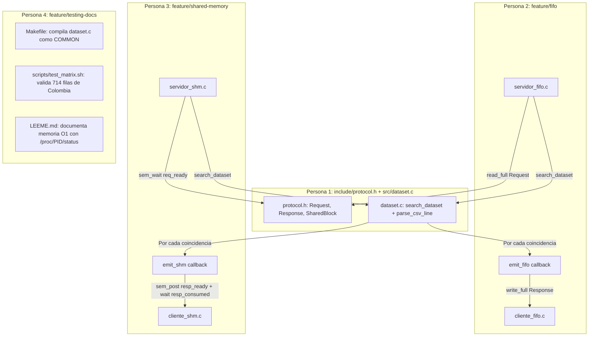

# Documentación Técnica: Capa Común de Protocolo y Dataset
**Rama:** `feature/dataset-protocol` | **Responsable:** Persona 1 | **Práctica 1 de Sistemas Operativos (UNAL)**

---

## 1. Propósito y Alcance de esta Rama

Esta rama contiene la **capa central e independiente de transporte** de todo el proyecto. Su objetivo es resolver dos problemas fundamentales antes de escribir una sola línea de código IPC:

1. **Definir el "idioma" común (`include/protocol.h`):** Congelar la estructura exacta de los paquetes de datos (`Request` y `Response`), los códigos de operación y la memoria compartida (`SharedBlock`), para que tanto la versión con tuberías nombradas (FIFO) como la versión con memoria compartida (SHM) transmitan exactamente la misma información.
2. **Implementar el acceso secuencial en disco al dataset (`include/dataset.h` y `src/dataset.c`):** Proveer un parser robusto para el archivo `data/worldcities.csv` (44.692 líneas) que lea línea por línea desde el disco con memoria constante ($O(1)$ RAM), maneje comillas dobles y comas internas, sea insensible a mayúsculas/minúsculas (`strcasecmp`) y emita resultados en streaming mediante callbacks.
3. **Validación unitaria (`tests/test_parser.c`):** Garantizar que la búsqueda funciona al 100% de manera autónoma, aislando cualquier bug del dataset de los futuros problemas de concurrencia e IPC.

---

## 2. Detalle Exhaustivo de lo que se Implementó

### 2.1. Protocolo Común (`include/protocol.h`)

El protocolo separa **qué se pide** de **cómo viaja**. No envía texto plano sin formato; envía estructuras C de tamaño fijo y predecible:

```c
#define VALUE_SIZE 128
#define TEXT_SIZE  512

#define FIFO_REQ   "/tmp/so_p1_req.fifo"
#define FIFO_RESP  "/tmp/so_p1_resp.fifo"
#define SHM_KEY    0x503141
```

#### Operaciones (`Operation`):
- `OP_CITY = 1`: Búsqueda por nombre de ciudad en formato ASCII (`city_ascii`, ej. `Bogota`, `Tokyo`).
- `OP_COUNTRY = 2`: Búsqueda por nombre de país (`country`, ej. `Colombia` -> devuelve múltiples registros).
- `OP_ISO2 = 3`: Búsqueda por código de dos letras (`iso2`, ej. `CO`, `JP`).
- `OP_EXIT = 4`: Señal de terminación controlada enviada por el cliente al servidor.

#### Tipos de Respuesta (`ResponseType`):
- `RESP_ROW = 1`: Contiene una fila coincidente formateada para mostrar al usuario.
- `RESP_END = 2`: Marca el fin de la transmisión de resultados para una consulta.
- `RESP_NOT_FOUND = 3`: Notifica que se recorrieron las 44.692 líneas y hubo 0 coincidencias.
- `RESP_ERROR = 4`: Notifica un error de apertura de archivo o procesamiento.
- `RESP_BYE = 5`: Confirmación del servidor reconociendo la salida y despidiéndose antes de liberar recursos.

#### Paquetes de Comunicación:
- **`Request`:** Estructura de tamaño constante ($132\text{ bytes}$) que transporta `int operation` y `char value[128]`.
- **`Response`:** Estructura de tamaño constante ($516\text{ bytes}$) que transporta `int type` y `char text[512]`.
- **`SharedBlock`:** Estructura que mapea el segmento System V en RAM para la Versión B:
  - 3 semáforos POSIX (`sem_t req_ready`, `sem_t resp_ready`, `sem_t resp_consumed`).
  - `int state` (ciclo de vida de la sincronización).
  - `Request request` y `Response response`.

---

### 2.2. Interfaz del Dataset (`include/dataset.h`)

Mapea formalmente las 11 columnas del archivo `worldcities.csv`:
```c
typedef enum {
    COL_CITY = 0,       /* "city" (Unicode, ej. Tōkyō) */
    COL_CITY_ASCII = 1, /* "city_ascii" (ASCII limpio, ej. Tokyo) */
    COL_LAT = 2,        /* "lat" */
    COL_LNG = 3,        /* "lng" */
    COL_COUNTRY = 4,    /* "country" (ej. Colombia, Japan) */
    COL_ISO2 = 5,       /* "iso2" (ej. CO, JP) */
    COL_ISO3 = 6,       /* "iso3" (ej. COL, JPN) */
    COL_ADMIN = 7,      /* "admin_name" (Departamento/Estado) */
    COL_CAPITAL = 8,    /* "capital" (primary, admin o vacio) */
    COL_POPULATION = 9, /* "population" */
    COL_ID = 10,        /* "id" (identificador numerico) */
    COL_COUNT = 11
} CityColumn;
```

#### Arquitectura de Callback Desacoplada:
```c
typedef int (*emit_response_fn)(const Response *resp, void *ctx);
```
Esta función puntero desacopla por completo la búsqueda del mecanismo IPC:
- `search_dataset()` no sabe qué es un socket, ni una FIFO, ni un semáforo.
- Solo sabe que cuando encuentra una fila, llama a `emit(&resp, ctx)`.
- Si `emit()` devuelve un número negativo, `search_dataset()` detiene la búsqueda de inmediato (protección ante desconexión o `SIGPIPE`).

---

### 2.3. Motor de Búsqueda y Parser Robusto (`src/dataset.c`)

#### ¿Por qué NO usamos `strtok()`?
La función estándar `strtok(line, ",")` comete dos errores graves con archivos CSV reales:
1. Si un campo contiene comas dentro de comillas (ej. `"Washington, D.C."`), `strtok` parte la ciudad en dos campos y desincroniza las columnas.
2. Si un campo está vacío entre dos comas consecutivas (ej. `...,"",...` en la columna de capitales), `strtok` se salta los delimitadores consecutivos y altera los índices de las columnas restantes.

#### Nuestra Solución: `parse_csv_line` in-place
Diseñamos un analizador que recorre la línea carácter a carácter:
1. **Limpieza de saltos de línea:** Remueve `\r` y `\n` al final de la línea para tolerar archivos guardados en Windows o Linux.
2. **Máquina de estados de comillas:**
   - Si el carácter inicial es `"`, activa el modo `in_quotes` y avanza.
   - Si encuentra `""` (comilla escapada dentro del texto), desplaza la memoria para conservar una sola comilla.
   - La coma `,` solo divide campos si está **fuera de comillas**.
   - Al encontrar el cierre del campo, reemplaza el delimitador por `\0` in-place (cero asignaciones dinámicas `malloc`, cero fugas).
   - Elimina las comillas exteriores para que el puntero apunte directamente al texto limpio (ej. `Tokyo` en vez de `"Tokyo"`).
3. **Relleno de seguridad:** Si una línea tiene columnas vacías al final, asegura que los 11 punteros `fields[0..10]` contengan al menos cadenas vacías `""` y nunca punteros nulos `NULL`.

#### Lectura Secuencial Streaming con `getline()`:
```c
int search_dataset(const char *path, const Request *req, emit_response_fn emit, void *ctx);
```
- **Cumplimiento estricto de la regla académica:** **El archivo NO se carga completo a RAM**.
- Abre `worldcities.csv` con `fopen(path, "r")` y verifica el retorno.
- Lee línea por línea usando `getline(&line, &capacity, fp)`.
- Reutiliza el mismo buffer en memoria, lo que significa que el proceso solo ocupa unos pocos kilobytes de memoria residente ($O(1)$ RAM), sin importar si el archivo pesa 4 MB o 100 GB.
- Compara con `strcasecmp()`: permite que el usuario busque `colombia`, `Colombia` o `COLOMBIA` y obtenga el mismo resultado.
- Formato limpio de salida para el cliente:
  `Ciudad: Bogota               | Pais: Colombia        | ISO2: CO | Region: Bogotá              | Poblacion: 7968095`
- Si no hay coincidencias emite `RESP_NOT_FOUND`.
- Siempre emite `RESP_END` al finalizar.
- Libera el buffer con `free(line)` y cierra el descriptor con `fclose(fp)`.

---

## 3. Cómo se Relaciona esta Capa con el Trabajo de los Demás

Este diagrama explica cómo las partes de Persona 2, Persona 3 y Persona 4 se acoplan con lo que acabamos de construir:



### 🤝 Para Persona 2 (Versión FIFO en `feature/fifo`):
1. En `src/servidor_fifo.c`, tu servidor solo debe incluir:
   ```c
   #include "protocol.h"
   #include "dataset.h"
   ```
2. Cuando el servidor lee un `Request` desde la FIFO de solicitudes con `read_full()`, define esta función callback:
   ```c
   static int emit_fifo(const Response *resp, void *ctx) {
       int fd_resp = *(int *)ctx;
       if (write_full(fd_resp, resp, sizeof(Response)) < 0) {
           return -1; /* Indica a search_dataset que el cliente se desconecto */
       }
       return 0;
   }
   ```
3. Y para ejecutar toda la búsqueda simplemente llamas a:
   ```c
   search_dataset(DATASET_DEFAULT_PATH, &req, emit_fifo, &fd_resp);
   ```
4. **¡Listo!** El servidor FIFO no tiene que parsear nada ni recorrer archivos; nosotros ya le entregamos cada respuesta lista para ser escrita en la tubería.

---

### 🤝 Para Persona 3 (Versión Memoria Compartida en `feature/shared-memory`):
1. En `src/servidor_shm.c`, tu servidor se mapea al bloque definido en `protocol.h`:
   ```c
   SharedBlock *shm = (SharedBlock *)shmat(shmid, NULL, 0);
   ```
2. Cuando el servidor despierta tras `sem_wait(&shm->req_ready)`, define el callback sincronizado:
   ```c
   static int emit_shm(const Response *resp, void *ctx) {
       SharedBlock *shm = (SharedBlock *)ctx;

       /* 1. Copiar la fila al unico slot de respuesta en RAM */
       memcpy(&shm->response, resp, sizeof(Response));

       /* 2. Despertar al cliente avisando que la respuesta esta lista */
       sem_post(&shm->resp_ready);

       /* 3. ESPERAR confirmacion de que el cliente leyo la fila (ACK) */
       sem_wait(&shm->resp_consumed);

       return 0;
   }
   ```
3. Y para atender la búsqueda simplemente llamas a:
   ```c
   search_dataset(DATASET_DEFAULT_PATH, &shm->request, emit_shm, shm);
   ```
4. **¡Esto elimina cualquier condición de carrera!** El servidor no sobrescribe la siguiente fila hasta que el cliente confirma que ya leyó la anterior con `resp_consumed`.

---

### 🤝 Para Persona 4 (Integración, Pruebas y LEEME en `feature/testing-docs`):
1. En el `Makefile`, define `src/dataset.c` dentro de los módulos comunes:
   ```makefile
   COMMON = src/dataset.c src/ipc_utils.c
   ```
2. En `scripts/test_matrix.sh`, puedes automatizar las pruebas con los números reales comprobados:
   - `city_ascii = "Tokyo"` $\rightarrow$ Exactamente 1 resultado.
   - `city_ascii = "Bogota"` $\rightarrow$ Exactamente 2 resultados (Colombia y Estados Unidos).
   - `country = "Colombia"` $\rightarrow$ Exactamente 714 resultados continuos.
   - `iso2 = "JP"` $\rightarrow$ Exactamente 1253 resultados.
   - `city_ascii = "AtlantisCity"` $\rightarrow$ 0 resultados (`RESP_NOT_FOUND`).
3. En `LEEME.md`, para la observación del sistema operativo sobre memoria:
   - Puedes usar `cat /proc/<PID>/status | grep VmRSS` durante una consulta de 714 filas y demostrarle al profesor que la memoria residente del proceso es de apenas ~1.2 MB y **no crece**, demostrando la lectura secuencial streaming.

---

## 4. Cómo Compilar y Verificar esta Rama

Para que cualquier integrante del equipo compruebe que esta base funciona al 100%:

```bash
# 1. Cambiarse a la rama
git checkout feature/dataset-protocol

# 2. Compilar el harness de prueba unitaria con gcc estricto
gcc -Wall -Wextra -Wpedantic -std=c11 -D_GNU_SOURCE -Iinclude src/dataset.c tests/test_parser.c -o test_parser

# 3. Ejecutar las pruebas
./test_parser
```

### Salida Esperada de la Prueba:
```text
==================================================
EJECUTANDO SUITE DE PRUEBAS UNITARIAS: DATASET & PARSER
Dataset objetivo: data/worldcities.csv
==================================================

TEST: Ciudad Tokyo (Exacta) (Op: 1, Criterio: 'Tokyo')
    [ROW 1] Ciudad: Tokyo                | Pais: Japan           | ISO2: JP | Region: Tōkyō              | Poblacion: 37732000
    [END] Busqueda finalizada. Total coincidencias encontradas: 1
--> Coincidencias retornadas: 1 ... PASS [OK]

TEST: Ciudad tokyo (Minusculas) ... PASS [OK]
TEST: Ciudad Bogota (Capital y US) ... PASS [OK] (2 filas)
TEST: Pais Colombia (714 ciudades) ... PASS [OK] (714 filas en streaming)
TEST: Codigo ISO2 'CO' ... PASS [OK] (714 filas)
TEST: Codigo ISO2 'JP' ... PASS [OK] (1253 filas)
TEST: Ciudad Inexistente (AtlantisCity) ... PASS [OK] (NOT_FOUND recibido)

==================================================
TODAS LAS PRUEBAS DE PERSONA 1 PASARON EXITOSAMENTE (100% OK)
==================================================
```

---

## 5. Resumen de Commits Realizados en esta Rama
- `include/protocol.h`: Definición de enums, structs `Request`, `Response`, `SharedBlock` y constantes de IPC.
- `include/dataset.h`: Encabezado de 11 columnas y prototipo del callback `emit_response_fn`.
- `src/dataset.c`: Parser CSV tolerante a comillas y búsqueda streaming línea a línea.
- `tests/test_parser.c`: Arnés unitario con 9 pruebas de validación automatizadas.
- `README_DATASET_PROTOCOL.md`: Este manual explicativo para el equipo.
